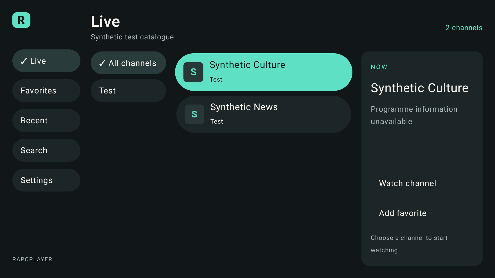

# RAPOPLAYER

A native, remote-operated Android TV / Google TV IPTV player MVP. Bring your own
authorized source. No channels, subscriptions, provider recommendations, analytics,
backend, recording, or content are supplied.

Kotlin · Compose for TV · Media3 · Room · Coroutines/Flow · OkHttp · DataStore.
Android 9/API 28 minimum; compile and target API 36. English resources initially.



The screenshot uses test fixtures, not bundled content. Validation currently
includes 32 JVM tests and 12 Android TV emulator tests. Physical playback
qualification remains required; see the exact [verification record](docs/TEST_RESULTS.md).
Additional emulator screenshots: [Welcome](docs/screenshots/welcome.png) ·
[Source setup](docs/screenshots/source-remote-focus.png).

## HTML prototype

Open [prototype/index.html](prototype/index.html) directly in your browser for an
interactive preview of the app. It is a single offline HTML file with fictional
channels, simulated playback/setup, remote-style keyboard navigation, and a mobile
layout. See [prototype instructions](prototype/README.md) for the demo controls.

## Build and install

Use JDK 17, Android SDK platform 36, build-tools 35.0.0 and the checked-in Gradle
8.13 wrapper. Open this directory in Android Studio, let it sync, and select an
Android TV virtual device or a physical Android/Google TV device. Put the local
SDK path in `local.properties` (`sdk.dir=C\:/path/to/Android/Sdk`); never commit it.
Copy [local.properties.example](local.properties.example) and replace its placeholder,
or set `ANDROID_HOME` to your SDK location.

```powershell
$env:JAVA_HOME = 'C:\path\to\jdk-17'
.\gradlew.bat clean testDebugUnitTest lintDebug assembleDebug assembleDebugAndroidTest
adb install -r app\build\outputs\apk\debug\app-debug.apk
adb shell am start -n com.rapoplayer.tv/.MainActivity
```

On macOS/Linux use `sh gradlew` and a local JDK 17/SDK. The Gradle wrapper JAR and
distribution have pinned SHA-256 verification. Versions are in
[`gradle/libs.versions.toml`](gradle/libs.versions.toml).

For this Windows workspace, `python scripts/bootstrap.py` optionally installs
workspace-local Microsoft OpenJDK 17, official Android SDK packages and Gradle.
Running it accepts the standard Android SDK license; review that license first.
It changes no system installations. SDK archives are checked against Google's
repository hashes and Gradle against its SHA-256. The JDK download uses normal
HTTPS. Then run:

```powershell
powershell -NoProfile -ExecutionPolicy Bypass -File scripts/build.ps1
```

The execution-policy option applies to that process only. The helper uses
`.tools` for its SDK, JDK and Gradle cache. Normal Android Studio builds do not
need these helpers. The original launcher assets are checked in; optional
`scripts/generate-brand.ps1` regenerates the 320×180 English banner.

## Use

1. Choose **Connect a source**, then M3U playlist or Xtream compatible.
2. Enter your authorized HTTP or HTTPS source details; HTTPS is preferred. A display name and XMLTV URL are
   optional. Choose HLS or TS for Xtream according to your provider's support.
3. Import, choose a category and channel, then select **Watch channel** or press
   OK on the channel. Merely focusing a channel never opens a stream.
4. OK during playback displays controls; Back closes controls before returning
   to browsing. Up/Down with controls hidden changes channels. Visible previous
   and next buttons work on minimal remotes. Media/channel keys work when present.
5. Settings offers refresh/reconnect, source editing/deletion, language and video
   preferences, guide/logo-cache clearing, history clearing, diagnostics, and a
   household PIN with category/channel locks.

Foreground departure releases the player and media session. Returning asks you
to resume; locked channels require the PIN again. Source credentials are never
saved into Android saved-instance state. After process death the cached browser
is restored, with no automatic playback. Back from the Live root follows the
system's exit behavior; there is no exit-confirmation trap.

Remote focus highlights text fields without opening the keyboard. Press OK/Enter
to edit; Done or Back hides the keyboard and keeps the value and field focus.
This applies to setup, search, PINs, restrictions and language preferences. Touch
can still open an editor directly. Input state containing credentials is never
saved into Android instance state. Short entrance/focus animations use Compose's
system-scaled animation clock, including disabled animations. Floating TV keyboards
use a compact editor, with the active field scrolled into view after resizing.

HTTP compatibility covers catalogue/authentication, guide, logos and playback.
HTTP sends credentials and media without encryption. No certificate checks are
disabled for HTTPS, and HTTPS redirects never silently downgrade to HTTP.

Keep the checked-in examples as placeholders. For private configuration, use
`config/source-config.local.json` or an untracked playlist, then enter the details
in the app's source form. Real playlists, local configuration, signing keys,
toolchains, caches, build outputs and logs are ignored by Git. The Gradle wrapper,
version catalogue, Room schemas and synthetic test fixtures remain tracked.

The optional PIN is a local household control, not protection against a
compromised device. Three incorrect attempts begin an exponential delay capped
at 60 seconds, persisted across restarts. There is no recovery code: forgetting
the PIN requires Android **Clear storage**, which deletes the entire source and
credentials as well as restrictions. Deleting a source through the app requires
the PIN and retains the household PIN for the next setup.

## Validation and release state

See [`docs/TEST_RESULTS.md`](docs/TEST_RESULTS.md) for the exact executed checks,
[`docs/CHECKLIST.md`](docs/CHECKLIST.md) for implementation status and
[`docs/PUBLISHING.md`](docs/PUBLISHING.md) for release gates. This is an MVP for
qualification, not a claim of universal provider or device compatibility.

- [Architecture and security boundaries](docs/ARCHITECTURE.md)
- [Formats, limits, identity and provider subset](docs/COMPATIBILITY.md)
- [Hardware/emulator acceptance procedure](docs/TESTING.md)
- [Placeholder configuration](examples/source-config.example.json)

No release signing key, service upload, app store publication or purchase is performed.
